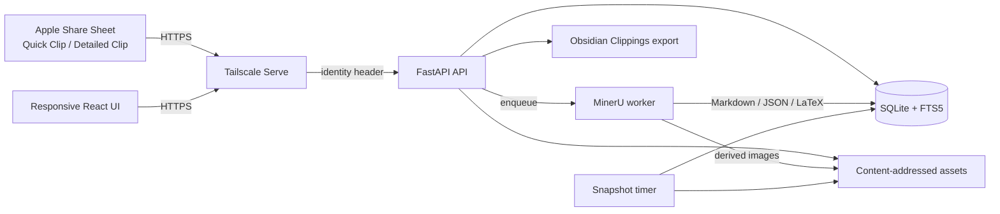

# Private Topic Clipper

> A self-hosted, cross-device research inbox for turning everyday reading into structured, AI-ready knowledge.

[](https://github.com/Cooperyichen/private-topic-clipper/actions/workflows/ci.yml)


Private Topic Clipper is a single-user capture and organization system built around one constraint: saving useful material should take seconds, while the original source remains available for later verification.

It accepts text, links, screenshots, images, PDFs, code, formulas, and timestamped video references from Apple Shortcuts or the web. Files are stored locally, processed asynchronously with MinerU, organized into reusable topics, and exported as stable Markdown plus JSON manifests for Obsidian or downstream AI workflows.

## Product walkthrough

1. **Capture quickly** from the iPhone or iPad share sheet with Quick Clip.
2. **Add context when it matters** with Detailed Clip notes, source titles, and video time ranges.
3. **Verify the source** through authenticated inline image and PDF previews.
4. **Organize without duplication** by referencing the same clip from multiple ordered topics.
5. **Export reproducibly** to Obsidian with checksums, conflict detection, and revision history.

The responsive interface is designed for iPad, desktop, and narrow mobile viewports. Inbox cards deliberately show only a title, optional personal note, and compact metadata; full OCR output remains available in the detail editor instead of overwhelming the browsing view.

## Architecture



FastAPI listens only on loopback. Tailscale Serve terminates tailnet HTTPS and supplies `Tailscale-User-Login`; the API accepts only the configured identity. Capture requests use idempotency keys, attachments are addressed by SHA-256, and user-provided paths never select server files directly.

See [Architecture and security](docs/ARCHITECTURE.md) for the trust boundaries and design tradeoffs.

## Engineering highlights

- **Asynchronous local extraction** — image and PDF uploads return after durable capture; one CPU worker processes MinerU `4.0.9` jobs without an external model API.
- **Original plus editable representations** — immutable source assets, editable text, OCR Markdown, plain text, and LaTeX remain distinct.
- **Safe attachment delivery** — authenticated asset lookup by database ID, normalized path-boundary checks, safe response headers, and PDF byte-range support.
- **Topic composition without copying** — many-to-many topic references preserve independent ordering and local annotations.
- **Conflict-aware export** — stable Markdown paths, adjacent manifests, checksums, revision history, and atomic replacement protect Obsidian edits.
- **Operational resilience** — systemd user services, WSL persistence guidance, journal rate limits, health checks, and consistent SQLite snapshots.
- **Explicit lifecycle semantics** — archiving remains reversible; permanent deletion requires confirmation and removes unreferenced assets and derived MinerU output.
- **48 automated tests** — 33 backend tests and 15 frontend tests cover capture, identity, idempotency, path safety, extraction, organization, export, deletion, previews, and video time formatting.

## Supported content

| Content | Capture | Local extraction | Original preview | Structured export |
| --- | --- | --- | --- | --- |
| Text / rich text | Yes | Not required | Immutable text | Markdown + manifest |
| Code / formulas | Yes | Not required | Immutable text | Fenced code / LaTeX |
| Links | Yes | Not required | Source URL | Source metadata |
| Video references | Yes | Not required | URL + time range | Timestamped reference |
| Images | Yes | MinerU | Responsive image | OCR + relative asset |
| PDF | Yes | MinerU | Embedded reader | OCR + relative assets |

The default per-file limit is `100 MiB`.

## Repository map

```text
backend/       FastAPI application, SQLite migrations, worker, exporter, backups
frontend/      React + TypeScript responsive interface and browser tests
ops/           Reproducible install, systemd, Tailscale Serve, WSL persistence
shortcuts/     Rebuildable Quick Clip and Detailed Clip specifications
docs/          Architecture and iteration history
```

## Quick start

### Prerequisites

- Linux or WSL with systemd
- Python `3.12` and [`uv`](https://docs.astral.sh/uv/)
- Docker for the pinned Node build
- Tailscale with Serve enabled
- An Obsidian vault for optional export

### Configure

```sh
cp .env.example .env
chmod 600 .env
```

Replace every `/absolute/path/...` value and set `CLIPPER_ALLOWED_LOGIN` to the exact tailnet login that Tailscale provides.

### Install

```sh
ops/install-runtime.sh
ops/install-user-services.sh
systemctl --user enable --now \
  clipper-api.service clipper-worker.service clipper-backup.timer
ops/configure-tailscale-serve.sh
ops/healthcheck.sh
```

The install scripts do not enable services or change Tailscale configuration automatically. Review the generated user units before enabling them.

### Build the Apple shortcuts

Follow [shortcuts/README.md](shortcuts/README.md). Apple signs exported shortcuts against the owner's account, so this repository stores reproducible action specifications rather than an unsigned shortcut binary.

## Development

Backend:

```sh
cd backend
uv sync --python 3.12 --extra dev --frozen
.venv/bin/ruff check app tests
.venv/bin/ruff format --check app tests
.venv/bin/python -m pytest -q
```

Frontend:

```sh
cd frontend
npm ci
npm test
npm run build
```

The production build uses the fixed `node:22.12.0-bookworm-slim` container described in the operations scripts. Browser tests use the pinned Playwright image.

## Backup and restore

The timer creates a consistent SQLite backup and copies content-addressed assets into a compressed archive. It retains the newest `14` daily and `8` weekly snapshots.

Stop the API and worker before restoring:

```sh
backend/.venv/bin/clipper-backup \
  --restore /absolute/path/to/snapshot.tar.gz \
  --confirm-restore
```

Restore validates archive paths and SQLite integrity, creates a pre-restore safety copy, replaces the database atomically, and merges missing immutable assets.

## Evolution

This repository preserves the implementation history rather than presenting the system as a one-shot demo. See [Iteration history](docs/ITERATIONS.md) for the progression from the first authenticated capture endpoint to the current cross-device workflow.

## Scope

The first version is intentionally single-user and tailnet-only. It does not include public sharing, full video hosting, external AI calls, automatic topic classification, a native client, or bidirectional Obsidian merging.

## Security and privacy

- Keep `.env`, runtime databases, assets, extraction output, and snapshots out of Git.
- Do not expose the attachment directory as unauthenticated static files.
- Review Tailscale ACLs and the configured identity before deployment.
- Use only synthetic material in screenshots, issues, and public demos.

This is a personal engineering project, not an audited security product.
