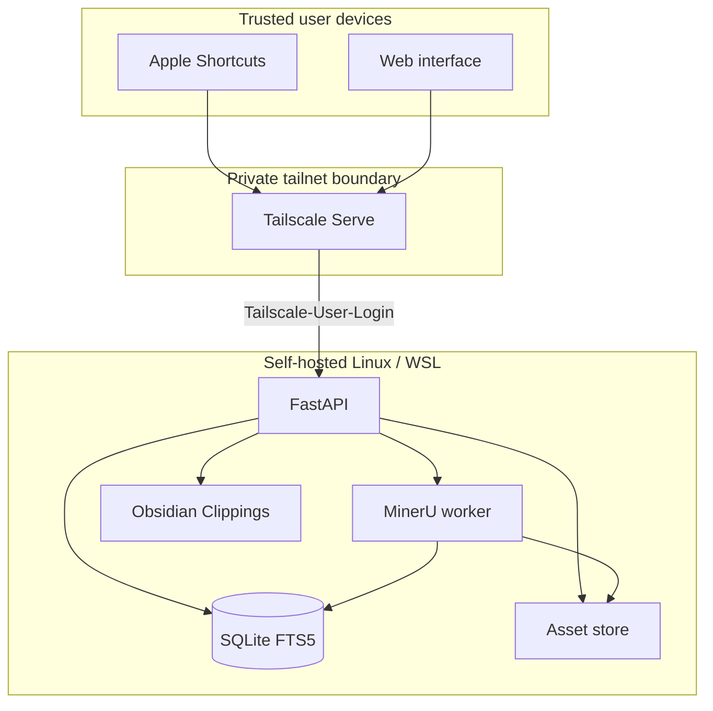

# Architecture and security

## Design goals

Private Topic Clipper optimizes for low-friction capture, preserved provenance, local processing, and reversible organization. It is not intended to replace a full note-taking system. Its job is to move heterogeneous material into a durable inbox and make later synthesis easier.

## Trust boundaries

The application server binds to `127.0.0.1`. Tailscale Serve is the only intended ingress and supplies the authenticated login header. The backend compares the normalized login with a single configured identity.

## Storage model

- **Clip** — type, lifecycle status, immutable source text, editable representation, source metadata, notes, and optional video positions.
- **Asset** — original filename, media type, size, SHA-256 checksum, and a server-controlled relative path.
- **Extraction job** — MinerU version, tier, lifecycle state, errors, and derived output paths.
- **Topic clip** — ordered many-to-many reference with a topic-local annotation and chosen representation.
- **Export revision** — checksum and application-owned history used for conflict detection and restoration.

Assets use content hashes so identical bytes share a stable storage identity. API clients never provide filesystem paths when reading an asset.

## Capture path

1. The client generates an idempotency key.
2. FastAPI validates identity, media type, size, and request fields.
3. The original is written durably and the database transaction records the clip.
4. Image and PDF clips enqueue an extraction job.
5. The capture response returns without waiting for MinerU.
6. A single local worker claims and processes jobs, then updates search content and derived representations.

## Attachment delivery

Authenticated reads use an Asset ID. The backend resolves the database record, normalizes the stored relative path, and verifies that the result remains inside the configured asset root. Response filenames are sanitized before entering `Content-Disposition`; the attachment directory is never mounted as public static content.

## Export safety

Topic export writes only below the configured `Clippings` directory. It generates a stable Markdown path, a JSON manifest, and relative attachment references. Before replacement, the exporter compares the current file checksum with the last application revision. A mismatch returns a conflict until the user explicitly confirms replacement. Confirmed writes save a revision and use temporary files plus atomic rename.

## Backup boundary

Snapshots use SQLite's backup API and include indexed immutable assets. Archive members are validated during restore; traversal, unsafe links, and invalid databases are rejected. Existing state receives a timestamped safety copy before replacement.

## Deliberate limitations

- Single configured user rather than multi-tenant authorization
- Tailnet availability instead of a public relay or offline queue
- CPU-only, single-concurrency MinerU worker
- No automatic topic classification or external language-model service
- One-way export rather than bidirectional Obsidian merge
